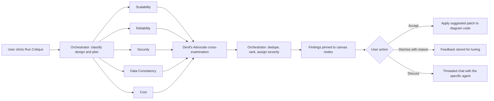
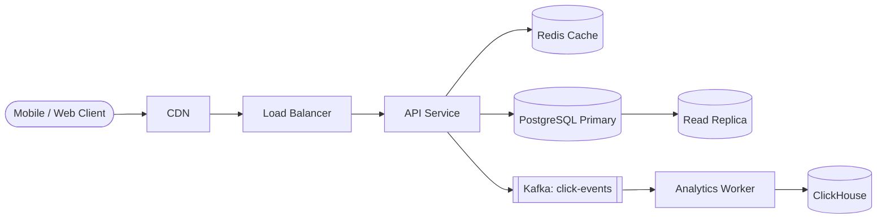
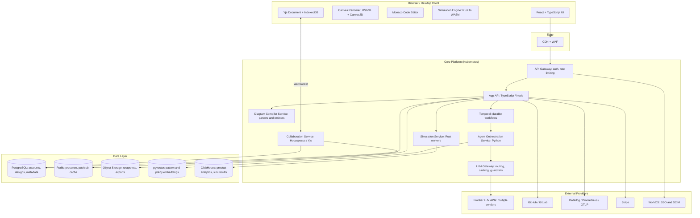
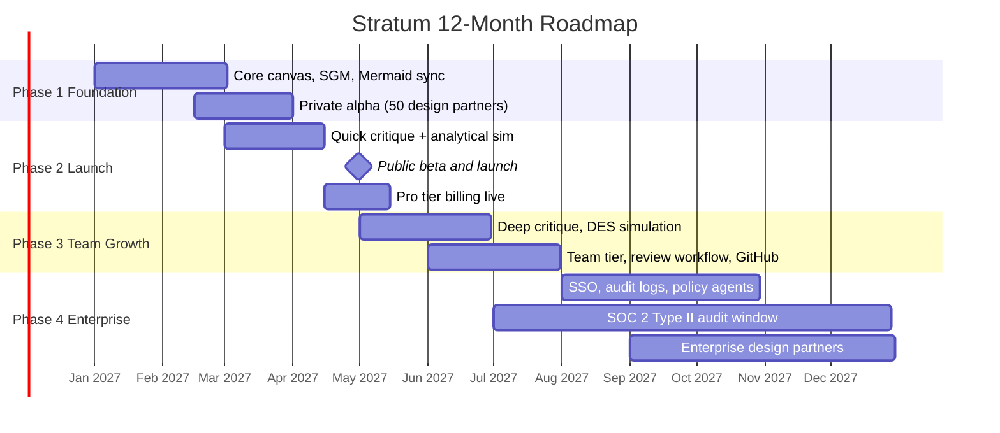

# Stratum: AI-Powered System Design Platform
## Product Specification and Business Plan

**Version:** 1.0 (Draft for review)
**Date:** November 23, 2026
**Product working name:** Stratum (placeholder; trademark search pending)
**Document owner:** Product and Founding Team

---

## Executive Summary

Stratum is a collaborative system design workspace where engineers draw, write, critique, and simulate software architectures in one place. It combines four capabilities that today live in separate tools or do not exist at all:

1. **Multi-agent architecture critique.** A panel of specialized AI reviewers (scalability, reliability, security, cost, data consistency) debates a design and leaves anchored, actionable findings on the canvas. The concept draws on the agent-team model popularized by Taskade Genesis, where [several agents work on one task](https://www.taskade.com/learn/genesis/overview), applied here to engineering review rather than business apps.
2. **Diagram-as-code generation.** Every diagram is backed by a typed graph model that round-trips to Mermaid, Eraser-style DSL, and D2. Users can edit visually or in code, and both stay in sync.
3. **Throughput and latency simulation.** Users annotate components with capacity and latency profiles, then run load scenarios that predict p50/p95/p99 latency, saturation points, queue growth, and cost per request before anything is built.
4. **Real-time collaborative canvas.** Multiplayer editing with presence, comments, branching, and design review workflows, built on a CRDT foundation.

**The gap.** Current tools cluster into two camps. Visual diagramming tools (Lucidchart, Miro) are general-purpose and do not understand system semantics. Developer diagramming tools (Eraser, Mermaid Chart) offer diagram-as-code and AI generation but stop at drawing. Eraser, for example, offers [AI diagrams, diagram-as-code, and real-time collaboration on every plan](https://www.eraser.io/pricing), yet none of these products tell you whether the design will hold up at 10x load or where it will fail. Stratum moves the category from "drawing architecture" to "validating architecture."

**Business targets (12 months post-launch):**

| Metric | Target |
|---|---|
| Cumulative signups | 40,000 |
| Weekly active users (WAU) | 8,000 |
| Paying seats | ~2,000 |
| Annual recurring revenue (run-rate) | ~$600K |
| Enterprise design partners | 3 to 5 |

---

## 1. Market Context

### 1.1 Market size

Analyst estimates for diagramming software vary widely by definition, but all point to steady double-digit growth:

- The Business Research Company sizes the diagramming software market at [$1.26 billion in 2026, growing to $1.88 billion by 2030 at a 10.5% CAGR](https://www.thebusinessresearchcompany.com/report/diagramming-software-global-market-report).
- OMR Global places it at [$2.5 billion in 2025, reaching $6.8 billion by 2035](https://www.omrglobal.com/industry-reports/diagramming-software-market), and notes that Microsoft and Lucid are adding AI diagram automation and real-time collaboration.
- The broader visual collaboration platforms market is estimated at [$12.7 billion in 2026](https://blog.9cv9.com/top-103-flowchart-software-statistics-data-trends-in-2026/).

**Stratum's serviceable market** is narrower and more valuable: technical diagramming for software teams (architecture, sequence, data flow, infrastructure). We estimate this segment at roughly 15 to 20% of diagramming spend, or about $200M to $400M today, with upside from adjacent budgets (architecture review, capacity planning, and developer productivity tooling) that diagram tools do not currently capture.

### 1.2 Why now

- **LLMs can now reason about architecture.** Frontier models can identify single points of failure, missing caches, and consistency hazards when given a structured graph, especially when multiple specialized prompts check each other.
- **Diagram-as-code is mainstream.** Mermaid is an MIT-licensed library with [every diagram type and the full renderer free](https://www.opensourcedrop.com/tools/mermaid-js/mermaid), and it renders natively in GitHub, GitLab, and Notion. Engineers expect diagrams to live in version control.
- **Collaboration infrastructure is mature.** CRDT libraries such as Yjs support [offline editing, version snapshots, undo/redo, and shared cursors](https://github.com/yjs/yjs/), so a small team can ship multiplayer editing without years of infrastructure work.
- **Agent workflows are familiar.** Products like Taskade Genesis have made multi-agent systems a known concept, reporting [500K+ deployed AI agents](https://www.taskade.com/blog/introducing-taskade-genesis).

### 1.3 Competitive landscape

| Product | Positioning | Entry paid price | Diagram-as-code | AI generation | Design critique | Simulation |
|---|---|---|---|---|---|---|
| Eraser | Engineer-focused diagrams and docs | [$45/member/mo annual, $60 monthly](https://www.eraser.io/pricing) | Yes (proprietary DSL) | Yes (credit-based) | No | No |
| Mermaid Chart | Hosted editor for Mermaid | [Plus $10/user/mo, Premium $20, annual only](https://mermaid.ai/docs/workspace-and-admin/manage-your-account) | Yes (Mermaid) | Yes (credit-based) | No | No |
| Lucidchart | General-purpose enterprise diagramming | [Individual $9/mo, Team $10/user/mo annual](https://lucid.app/pricing/lucidchart) | Yes | Yes (Lucid AI) | No | No |
| Taskade Genesis | No-code AI app and agent builder | [Pro from $10/mo annual](https://www.taskade.com/ai/apps) | No | App generation | General-purpose agents | No |
| D2, PlantUML, Structurizr | Open-source diagram languages | Free | Yes | Limited | No | No |
| **Stratum** | **Design, critique, and simulate architecture** | **$15/user/mo annual** | **Yes (Mermaid, Eraser-style, D2)** | **Yes** | **Yes (multi-agent)** | **Yes** |

**Key competitive observations:**

- Eraser is the closest competitor and recently moved upmarket. Its free plan is limited to [3 files and 3 AI credits](https://docs.eraser.io/plans), and reviewers report that a [$15 Starter tier was removed](https://theproofdesk.com/eraser-review) in late 2026. This leaves a pricing gap between $20 and $45 per seat that Stratum can fill.
- Mermaid Chart is inexpensive but has [no monthly billing option](https://reviewgalore.com/pricing/mermaid-chart), and its value is tied to a single syntax.
- Lucidchart is strong in enterprise distribution but recently [shifted to bundle pricing with 35 to 50% rate increases](https://pricingsaas.com/companies/lucid), which creates switching opportunities among cost-sensitive engineering teams.
- No identified competitor offers quantitative simulation or structured multi-agent critique. This is Stratum's defensible wedge.

---

## 2. Target User Personas

### 2.1 Primary persona: the Tech Lead

**Name:** Arjun Mehta, Senior Backend Engineer / Tech Lead
**Company:** Series B to D SaaS or fintech company, 80 to 600 engineers
**Location:** Bengaluru, Berlin, Austin, or remote

| Attribute | Detail |
|---|---|
| Responsibilities | Writes design docs (RFCs) for new services, leads design reviews, owns on-call for 2 to 4 services |
| Current tools | Eraser or Excalidraw for diagrams, Mermaid in GitHub READMEs, Google Docs or Notion for RFCs, spreadsheets for capacity math |
| Frequency | Produces 1 to 3 design docs per month; reviews 3 to 6 more |
| Core pain | Design reviews are slow and depend on whether a senior architect is free. Capacity estimates are back-of-the-envelope and often wrong. Diagrams drift from reality within weeks. |
| Job to be done | "Help me ship a design my staff engineer will approve on the first review, with numbers to back it up." |
| Buying behavior | Starts on free tier, expenses Pro on a card, then champions a Team plan for their squad |
| Success signal | Design review cycles drop from 2 to 3 rounds to 1; fewer production incidents traced to design flaws |

### 2.2 Secondary persona: the Principal Architect (economic buyer)

**Name:** Sarah Okafor, Principal Engineer / Head of Architecture
**Company:** Enterprise (2,000+ engineers), regulated industry (banking, healthcare, telecom)

| Attribute | Detail |
|---|---|
| Responsibilities | Runs the Architecture Review Board, sets standards, approves high-risk designs |
| Core pain | Reviews are a bottleneck; standards are inconsistently applied; no audit trail of why a design was approved |
| Job to be done | "Scale my judgment across 40 teams without becoming the bottleneck." |
| Must-haves | SSO/SCIM, audit logs, custom critique rules ("all PII services must use KMS envelope encryption"), data residency, no training on customer data |
| Buying behavior | Annual contract, security review, procurement; 3 to 6 month sales cycle |

### 2.3 Tertiary persona: the Learner (acquisition channel)

**Name:** Kavya R., Final-year CS student or engineer preparing for system design interviews

| Attribute | Detail |
|---|---|
| Core pain | System design interviews require practice with feedback, which is expensive (mock interviews cost $100 to $300 each) |
| Job to be done | "Practice designing Twitter or Uber and get feedback like a real interviewer." |
| Value to Stratum | High-volume, low-cost acquisition; strong social sharing; converts to Pro or becomes a champion at their next employer |

### 2.4 Anti-personas (not targeting in year one)

- Business analysts drawing BPMN or org charts (served well by Lucidchart and Miro)
- Network engineers needing vendor-specific physical topology tools
- Teams wanting full infrastructure-as-code generation and deployment (adjacent but out of scope)

---

## 3. Product Vision and Principles

**Vision:** Every system is designed, challenged, and validated before a single line of production code is written.

**Product principles:**

1. **Semantics over pixels.** A box labeled "Postgres" is a database with properties, not just a rectangle. All intelligence depends on this.
2. **Code and canvas are equal citizens.** Any change in one is reflected in the other, losslessly.
3. **Show your work.** Every AI finding and simulation result explains its reasoning and assumptions. No black-box verdicts.
4. **Humans decide.** Agents suggest; users accept, reject, or discuss. Nothing changes the design without consent.
5. **Fast feedback.** Critique in under 60 seconds; quick simulation in under 2 seconds in the browser.

---

## 4. Core Feature Specification

### 4.1 Foundation: the Stratum Graph Model (SGM)

All four features depend on a shared, typed internal representation of a system design. This is the most important architectural decision in the product.

```
Design
 ├── Nodes[]        id, kind (service | database | cache | queue | gateway | cdn |
 │                  load_balancer | external | client | function | storage | stream),
 │                  label, tech (e.g. "PostgreSQL 16"), properties{}, perf_profile{}
 ├── Edges[]        id, source, target, protocol (http | grpc | amqp | kafka | sql | ws),
 │                  sync | async, payload_size, call_ratio, retry_policy
 ├── Groups[]       regions, VPCs, availability zones, bounded contexts
 ├── Annotations[]  comments, critique findings, decisions (ADR links)
 └── Scenarios[]    load profiles, failure injections, traffic mix
```

- **Rendering layer:** The canvas renders SGM; layout coordinates are stored separately so that code edits do not destroy manual layout.
- **Code layer:** Parsers and emitters convert SGM to and from each supported syntax.
- **Intelligence layer:** Agents and the simulator read SGM directly, never raw pixels.

### 4.2 Feature A: Multi-Agent Architecture Critique

#### Problem
Design review quality depends on which senior engineer is available. Junior and mid-level engineers lack fast, rigorous feedback. Architecture Review Boards become bottlenecks.

#### Solution
A panel of specialized AI agents reviews the design in parallel, cross-examines each other's findings, and produces a prioritized, deduplicated report anchored to specific nodes and edges on the canvas.

#### Agent roster

| Agent | Focus | Example finding |
|---|---|---|
| **Orchestrator** | Plans the review, assigns agents, merges and ranks findings | "Running 6 reviewers; skipping Compliance (no PII detected)" |
| **Scalability Reviewer** | Bottlenecks, fan-out, hot partitions, horizontal scaling limits | "Feed Service makes N+1 calls to User Service; at 5K RPS this produces 250K internal RPS" |
| **Reliability (SRE) Reviewer** | Single points of failure, retries, timeouts, circuit breakers, blast radius | "Single-AZ Redis is a SPOF for session auth; recommend replica in a second AZ" |
| **Security Reviewer** | AuthN/Z boundaries, secrets, encryption, OWASP and STRIDE threats | "Public API Gateway forwards to internal gRPC with no auth propagation" |
| **Data Consistency Reviewer** | Transactions, dual writes, idempotency, ordering, CAP trade-offs | "Order Service writes to DB and Kafka separately; use the outbox pattern" |
| **Cost (FinOps) Reviewer** | Over-provisioning, egress, expensive managed services | "Cross-region replication of logs adds an estimated $4.2K/month in egress" |
| **Compliance Reviewer** (Team+) | GDPR, HIPAA, PCI-DSS, SOC 2 controls, data residency | "EU user data replicates to us-east-1 without documented transfer mechanism" |
| **Devil's Advocate** | Challenges the other agents' findings to reduce false positives | "Disputes the caching finding: read/write ratio is 1:1, so cache hit rate would be low" |

#### Review workflow



#### Finding structure
Each finding includes: severity (Critical / High / Medium / Low / Info), category, the affected nodes and edges, a plain-language explanation, the evidence used (for example, simulation output or properties), a suggested fix, and a proposed patch expressed as a diff to the diagram code. Accepting a patch applies it as a single undoable change.

#### Modes
- **Quick review** (about 20 seconds): Orchestrator plus 3 core agents, single pass.
- **Deep review** (about 60 to 90 seconds): All relevant agents, a debate round, and simulation evidence attached.
- **Interview mode:** A single "interviewer" agent asks probing follow-up questions instead of giving answers, and scores the design against a rubric.
- **Policy review** (Enterprise): Custom organizational rules written in plain language or a simple rule DSL, enforced as an additional agent.

#### Requirements

| Priority | Requirement | Acceptance criteria |
|---|---|---|
| P0 | Run critique on any saved design | Given a design with 3+ nodes, when the user runs Quick review, then findings return in under 30 s at p95 |
| P0 | Findings anchored to canvas | Given a finding referencing a node, when the user clicks it, then the canvas pans to and highlights that node |
| P0 | Accept or dismiss findings | Given a finding with a patch, when the user accepts, then the diagram updates and the change is undoable in one step |
| P0 | Explain reasoning | Every finding shows the evidence and assumptions used; findings without evidence are not shown |
| P1 | Debate round with Devil's Advocate | Disputed findings are labeled "contested" with both arguments visible |
| P1 | Chat with an individual agent about a finding | Thread persists on the finding and is visible to collaborators |
| P1 | Critique diff between versions | Given two versions, show resolved, new, and persisting findings |
| P2 | Custom organizational policies | Admin can define up to 50 rules; violations appear as findings tagged "Policy" |
| P2 | GitHub PR bot | Critique runs automatically when a diagram file changes in a pull request |

#### Quality targets
- Precision (findings rated "useful" by users): 70% or higher at launch, 80% by month 12
- Critical-severity false positive rate: under 10%
- Benchmark: an internal evaluation set of 300 annotated designs with known flaws (seeded from public post-mortems and classic interview problems), run on every model or prompt change

### 4.3 Feature B: Diagram-as-Code Generation

#### Problem
Engineers want diagrams in version control, but each syntax has a learning curve, visual editors do not produce clean code, and teams are split across Mermaid, PlantUML, D2, and proprietary formats.

#### Solution
Bidirectional sync between the canvas, a code editor, and natural language. Users can start from any of the three and export to any supported syntax.

#### Input methods
1. **Natural language:** "Design a URL shortener handling 10K writes/s and 500K reads/s with analytics."
2. **Code:** Paste or write Mermaid, Eraser-style DSL, or D2.
3. **Visual:** Drag components from a library of 3,000+ cloud and technology icons.
4. **Import:** From a GitHub repo (docker-compose, Kubernetes manifests, Terraform), an image or whiteboard photo, or existing Mermaid in Markdown files.

#### Supported syntaxes

| Syntax | Read | Write | Notes |
|---|---|---|---|
| Mermaid (flowchart, sequence, ER, C4, architecture-beta) | Yes | Yes | Primary export format; renders natively in GitHub and Notion |
| Eraser-style DSL (architecture, sequence, ERD) | Yes | Yes | Compatible with the general syntax pattern; no proprietary features copied |
| D2 | Yes | Yes | P1 |
| PlantUML | Yes | Yes | P2 |
| Stratum native (SGM YAML) | Yes | Yes | Lossless; includes performance profiles and scenarios |

#### Example output for the same design

**Mermaid:**


**Eraser-style DSL:**
```
Client [icon: smartphone]
CDN [icon: aws-cloudfront]
LB [icon: aws-elb, label: "Load Balancer"]
API Service [icon: server]
Data Tier [color: blue] {
  Redis [icon: redis]
  Postgres Primary [icon: postgres]
  Read Replica [icon: postgres]
}
Kafka [icon: kafka]
Analytics Worker [icon: server]
ClickHouse [icon: database]

Client > CDN > LB > API Service
API Service > Redis
API Service > Postgres Primary
Postgres Primary > Read Replica: async replication
API Service > Kafka: click events
Kafka > Analytics Worker > ClickHouse
```

**Stratum native (excerpt with performance profile):**
```yaml
nodes:
  - id: api
    kind: service
    tech: "Go 1.23"
    perf:
      instances: 6
      concurrency_per_instance: 200
      service_time_ms: { dist: lognormal, p50: 4, p99: 18 }
  - id: cache
    kind: cache
    tech: "Redis 7"
    perf:
      hit_ratio: 0.92
      service_time_ms: { dist: fixed, value: 0.6 }
edges:
  - from: api
    to: cache
    protocol: tcp
    sync: true
    calls_per_request: 1
```

#### Requirements

| Priority | Requirement | Acceptance criteria |
|---|---|---|
| P0 | Live two-way sync between canvas and code | Given a code edit, when it parses, then the canvas updates in under 150 ms without losing manual layout of unchanged nodes |
| P0 | Natural language to diagram | Given a prompt, then a valid diagram renders in under 15 s at p95, with assumptions listed |
| P0 | Export to Mermaid and Eraser-style DSL | Exported Mermaid renders correctly in GitHub for 100% of the test suite |
| P0 | Clear parse errors | Invalid code shows line-level errors; canvas keeps last valid state |
| P1 | AI edit by instruction | "Add a dead-letter queue to the payments consumer" produces a reviewable diff |
| P1 | Import from docker-compose, Kubernetes YAML, Terraform | 90% of nodes and edges correctly inferred on benchmark repos |
| P1 | Git sync | Bidirectional sync with a `.stratum/` folder in a repo; changes appear as commits or PRs |
| P2 | Image and whiteboard photo import | Recognizes boxes, arrows, and labels with 85%+ accuracy on benchmark set |
| P2 | VS Code and JetBrains extensions | Preview and edit diagrams alongside code |

### 4.4 Feature C: Automated Throughput and Latency Simulation

#### Problem
Capacity planning happens in spreadsheets or not at all. Teams discover bottlenecks in production load tests or, worse, during incidents. Back-of-the-envelope math rarely accounts for fan-out, queueing, tail latency, or retries.

#### Solution
A simulation engine that uses the design graph and per-component performance profiles to predict system behavior under load. It offers two engines: a fast analytical model for instant feedback and a discrete-event simulator for accuracy on complex scenarios.

#### Engine 1: Analytical model (instant, in-browser)
Each node is modeled as a queueing station. For a node with \( c \) servers, arrival rate \( \lambda \), and service rate \( \mu \) per server:

\[ \rho = \frac{\lambda}{c\,\mu} \]

When \( \rho \geq 1 \), the node is saturated and its queue grows without bound. Waiting time is estimated with the Erlang C formula for M/M/c queues, and end-to-end latency is composed along each request path, accounting for synchronous versus asynchronous edges and fan-out ratios. Little's Law, \( L = \lambda W \), gives in-flight request counts used to check connection pool and thread limits.

- Runs in under 2 seconds for designs with up to 200 nodes
- Updates live as users drag a traffic slider
- Ideal for "what happens at 2x, 5x, 10x traffic?"

#### Engine 2: Discrete-event simulation (accurate, server-side)
A Monte Carlo discrete-event simulator, written in Rust and also compiled to WebAssembly for smaller runs in the browser, models:

- Non-exponential service time distributions (lognormal, Pareto tails, empirical histograms)
- Cache hit/miss ratios, connection pools, thread pools, and rate limits
- Retries with backoff, timeouts, and retry storms
- Autoscaling policies with warm-up delays
- Failure injection: kill a node, add 200 ms network latency to a region, drop an availability zone
- Traffic shapes: steady, diurnal, spike (flash sale), and replayed production traces (Enterprise)

#### Simulation outputs
- **Latency percentiles** (p50, p95, p99, p99.9) end-to-end and per hop
- **Throughput ceiling:** the maximum requests per second before SLO breach
- **Bottleneck ranking:** which node saturates first, and at what load
- **Utilization heatmap** overlaid on the canvas (green to red per node)
- **Queue depth over time** for async components
- **Cost estimate** per million requests, using public cloud pricing tables
- **SLO check:** pass or fail against user-defined targets (for example, p99 under 300 ms at 20K RPS)

#### Performance profile library
Users rarely know service times. Stratum ships with a curated library of default profiles (for example, "Redis GET on same-AZ: p50 0.3 ms", "Postgres indexed read: p50 1 to 3 ms", "cross-region RTT us-east-1 to eu-west-1: about 75 ms") with clear sources and ranges. Users can override defaults and, on Team and Enterprise tiers, import real measurements from Datadog, Prometheus, or OpenTelemetry to calibrate models.

#### Integration with critique
Simulation results feed directly into the critique agents as evidence. The Scalability Reviewer cites "API Service reaches 94% utilization at 8K RPS in simulation" rather than speculating. Accepting a fix (for example, adding a read replica) can automatically trigger a re-simulation to show the improvement.

#### Requirements

| Priority | Requirement | Acceptance criteria |
|---|---|---|
| P0 | Analytical simulation with traffic slider | Results update in under 2 s for designs up to 200 nodes |
| P0 | Default performance profiles for 50+ common components | Each default shows its source and range |
| P0 | Bottleneck identification and utilization heatmap | Saturated nodes are highlighted and ranked |
| P0 | Assumption transparency | Every result lists the inputs and model used; results labeled "estimate" |
| P1 | Discrete-event simulation with percentile output | 10-minute simulated window at 50K RPS completes in under 60 s |
| P1 | Failure injection scenarios | User can disable a node or zone and see the impact |
| P1 | SLO definitions and pass/fail checks | SLO status shown in the design header |
| P1 | Cost per million requests | Uses AWS, GCP, and Azure public price lists, refreshed monthly |
| P2 | Calibration from observability data | Import latency histograms from Datadog, Prometheus, or OTLP |
| P2 | Simulation comparison between design versions | Side-by-side percentile and cost deltas |

#### Accuracy goal and honesty policy
The goal is directional accuracy: predictions within plus or minus 25% of measured p95 latency on calibrated designs, validated against a benchmark of reference architectures load-tested in a lab. The UI will always present results as estimates and will never claim to replace real load testing.

### 4.5 Feature D: Real-Time Collaborative Canvas

#### Problem
Design reviews involve many people across time zones. Static images in docs go stale, and comment threads scatter across Slack, Google Docs, and PR comments.

#### Solution
A multiplayer infinite canvas with live cursors, comments, version branching, and a structured review workflow.

#### Capabilities
- **Live multiplayer editing:** Cursors, selections, and presence for up to 50 concurrent editors per design; unlimited viewers.
- **Follow mode and spotlight:** Presenters lead others through a design during meetings.
- **Comments and threads:** Anchored to nodes, edges, or code lines; @mentions; resolve and reopen.
- **Branching:** Create a branch of a design ("Option B: event-driven"), compare side-by-side, merge back. Mirrors Git mental models.
- **Version history:** Named snapshots and full timeline playback.
- **Design review workflow:** Request review, assign reviewers, track approval status, and record decisions as Architecture Decision Records (ADRs).
- **Linked docs:** A Markdown design doc lives beside each canvas, with embedded live diagram views.
- **Offline editing:** Changes merge automatically on reconnect.
- **Guests:** Unlimited free view and comment guests on paid plans.

#### Requirements

| Priority | Requirement | Acceptance criteria |
|---|---|---|
| P0 | Real-time sync of canvas and code | Remote edits appear in under 200 ms at p95 for users on the same continent |
| P0 | Presence and live cursors | Visible for all active collaborators |
| P0 | Comments anchored to elements | Comments follow their node when it moves |
| P0 | Version history with restore | Restore creates a new version; nothing is destroyed |
| P0 | Conflict-free concurrent editing | Two users editing the same node property converge deterministically with no data loss |
| P1 | Branching and compare | Visual diff highlights added, removed, and changed elements |
| P1 | Review requests and approvals | Approval state visible on design and exportable |
| P1 | Offline editing | Up to 24 hours offline; merges on reconnect |
| P2 | Follow mode and presentation mode | Presenter's viewport is mirrored to followers |
| P2 | Embeds in Notion, Confluence, and GitHub | Live-updating embeds |

### 4.6 Supporting features

| Feature | Description | Priority |
|---|---|---|
| Template gallery | 100+ reference architectures (URL shortener, chat app, payments, RAG pipeline, video streaming) with pre-filled performance profiles | P0 |
| Integrations | GitHub, GitLab, Jira, Linear, Slack, Notion, Confluence | P1 |
| API and MCP server | Let AI coding agents read, create, and critique designs programmatically | P1 |
| Exports | PNG, SVG, PDF, Markdown with embedded Mermaid | P0 |
| Admin console | Seats, SSO, SCIM, audit logs, data retention | P1 (Enterprise) |

### 4.7 Non-goals (year one)

1. **Infrastructure deployment.** Stratum will not provision infrastructure or generate production Terraform. It may export starter IaC as a P2 experiment only.
2. **General-purpose whiteboarding.** No sticky-note brainstorming, mind maps, or BPMN. Focus remains on technical system design.
3. **Replacing load testing.** Simulation is for early validation, not a substitute for k6, Gatling, or production testing.
4. **Code generation for services.** Generating application code is a different product with different competitors.
5. **Self-hosted or on-premise deployment.** Deferred to year two; single-tenant cloud is offered to Enterprise instead.

---

## 5. User Journeys

### 5.1 Tech Lead: design to approval
1. Arjun types: "Design a notification service sending 50M push and email notifications per day with retries and user preferences."
2. Stratum generates a diagram and Mermaid code in about 10 seconds, listing assumptions (peak factor 5x, 3 channels).
3. He adjusts the design on the canvas, adding a priority queue.
4. He runs the analytical simulation: the email provider adapter saturates at 1,200 messages/s.
5. He runs Deep Critique: 2 High findings (no idempotency key on retries; single-region queue) and 4 Medium findings.
6. He accepts 3 patches, re-simulates (passes SLO), and requests review from his staff engineer.
7. The staff engineer comments on two nodes and approves. The decision is saved as an ADR.
8. Arjun exports Mermaid into the RFC in GitHub.

**Target time:** under 90 minutes, compared with a typical 1 to 2 weeks across multiple review rounds.

### 5.2 Learner: interview practice
1. Kavya picks "Design WhatsApp" from the practice library.
2. She draws a design while a timer runs (45 minutes).
3. Interview mode asks: "What happens when a user is offline for 3 days?" and "How do you guarantee message ordering?"
4. She receives a rubric score and a comparison with a reference design.
5. She shares her result card on LinkedIn, driving signups.

---

## 6. Technical Architecture

### 6.1 High-level architecture



### 6.2 Technology stack

| Layer | Choice | Rationale |
|---|---|---|
| Frontend framework | React 19, TypeScript, Vite | Largest talent pool; mature ecosystem |
| Canvas | Custom renderer on PixiJS (WebGL) with Canvas2D fallback; React Flow (xyflow) for early prototype | WebGL handles 2,000+ elements smoothly; prototype fast with xyflow, then migrate hot paths |
| Auto-layout | ELK.js (Eclipse Layout Kernel) in a Web Worker | Best-in-class layered layouts for architecture graphs |
| Code editor | Monaco with custom language servers for each DSL | Syntax highlighting, autocomplete, inline errors |
| Diagram compiler | TypeScript parsers (Chevrotain or Lezer grammars) shared between client and server | One codebase for parsing on both sides; deterministic output |
| Real-time collaboration | Yjs CRDT with Hocuspocus server; y-indexeddb for offline | Yjs is [network agnostic and supports offline editing, snapshots, and shared cursors](https://github.com/yjs/yjs/); Hocuspocus adds [pluggable persistence and token-based auth](https://www.syncfusion.com/blogs/post/react-collaborative-block-editor-yjs) |
| Horizontal scaling for collab | Redis pub/sub (y-redis pattern), room-partitioned routing | Proven pattern for fanning out updates across stateless sync servers |
| App API | Node.js (TypeScript), Fastify, tRPC for internal and REST/OpenAPI for public | Shared types with frontend; fast |
| Simulation engine | Rust core, compiled to native for server and WebAssembly for browser | Performance for Monte Carlo runs; one engine in two places |
| Agent orchestration | Python service using LangGraph-style state graphs; Temporal for durable execution | Python has the strongest AI tooling; Temporal handles retries and long runs |
| LLM gateway | Internal gateway with model routing (frontier models for deep critique, smaller models for parsing and classification), prompt caching, output validation | Controls cost, avoids vendor lock-in, enforces structured output |
| Structured output | JSON Schema-validated findings; graph patches as JSON Patch over SGM | Prevents hallucinated node IDs; patches are verifiable |
| Primary database | PostgreSQL 16 (managed, e.g. Amazon Aurora) with pgvector | Reliable, relational metadata plus embeddings in one store |
| Cache and presence | Redis 7 (managed) | Pub/sub, rate limiting, presence |
| Analytics store | ClickHouse | High-volume event and simulation analytics |
| Object storage | Amazon S3 | Snapshots, exports, CRDT update logs |
| Infrastructure | AWS (us-east-1, eu-west-1, ap-south-1), EKS, Terraform, Argo CD | Multi-region for latency and data residency from day one |
| Auth | WorkOS (SSO, SCIM), plus email, Google, and GitHub OAuth | Enterprise readiness without building SAML in-house |
| Billing | Stripe Billing with usage metering for AI credits | Standard; supports seats plus usage |
| Observability | OpenTelemetry, Grafana, Sentry | Vendor-neutral tracing |
| Security | SOC 2 Type II program (via Vanta or Drata), encryption at rest and in transit, per-tenant encryption keys for Enterprise | Required for enterprise sales |

### 6.3 AI system design

**Model strategy:**
- **Tier 1 (frontier reasoning models):** Deep critique agents and Devil's Advocate.
- **Tier 2 (fast mid-size models):** Quick critique, natural language to diagram, AI edits.
- **Tier 3 (small or fine-tuned models):** Component classification, label normalization, icon matching.
- Multiple vendors behind the LLM gateway to manage outages and pricing changes.

**Grounding and reliability:**
- Agents receive the SGM as structured input plus simulation results, never a screenshot alone.
- A pattern library (retrieval over a curated corpus of architecture patterns, anti-patterns, and anonymized public post-mortems) grounds findings in known failure modes.
- All agent outputs pass a validator that rejects references to nonexistent nodes and malformed patches.
- Evaluation harness runs on every prompt or model change against the 300-design benchmark; regressions block release.

**Data privacy:**
- Customer designs are never used to train third-party models; zero-retention agreements with LLM vendors.
- Enterprise tier offers bring-your-own-model-key and regional model endpoints.
- Opt-in only for using dismissed or accepted findings to improve Stratum's own prompts and rankers.

### 6.4 Non-functional requirements

| Category | Target |
|---|---|
| Availability | 99.9% (Pro/Team), 99.95% SLA (Enterprise) |
| Canvas performance | 60 fps panning with 1,000 elements; usable at 5,000 |
| Collaboration latency | Under 200 ms p95 for same-region peers |
| Analytical simulation | Under 2 s for 200 nodes |
| Quick critique | Under 30 s p95 |
| Data durability | 99.999999999% for snapshots (S3); point-in-time recovery for 35 days |
| Security | SOC 2 Type II by month 12; annual penetration test; GDPR and DPDP Act (India) compliance |
| Accessibility | WCAG 2.2 AA for non-canvas UI; keyboard navigation and screen-reader summaries of diagrams |

---

## 7. Pricing and Packaging

### 7.1 Pricing strategy

Stratum is priced in the gap between Mermaid Chart's [$10 to $20 per user](https://mermaid.ai/docs/workspace-and-admin/manage-your-account) and Eraser's [$45 per member annually](https://www.eraser.io/pricing), with simulation and critique as differentiated value that justifies a premium over pure diagramming. Unlike Mermaid Chart, Stratum offers monthly billing on every paid tier. AI usage is metered with credits to protect margins, but each tier includes enough credits for typical use, so most users never think about them.

**Credit definitions:**
- Quick critique = 1 credit
- Deep critique = 5 credits
- AI diagram generation or AI edit = 1 credit
- Discrete-event simulation run = 2 credits (analytical simulation is always free and unlimited)

### 7.2 Tiers

| | **Free** | **Pro** | **Team** | **Enterprise** |
|---|---|---|---|---|
| **Price (annual)** | $0 | $15/user/mo | $29/user/mo | Custom (from ~$45/user/mo, min. 50 seats) |
| **Price (monthly)** | $0 | $19/user/mo | $36/user/mo | Annual contracts |
| **Target** | Learners, evaluators | Individual engineers | Engineering teams (3 to 200) | Large organizations, regulated industries |
| Designs | 5 | Unlimited | Unlimited | Unlimited |
| AI credits / month | 20 | 200 | 500 per user (pooled) | Unlimited (fair use) or committed volume |
| Diagram-as-code (all syntaxes) | Yes | Yes | Yes | Yes |
| Analytical simulation | Yes | Yes | Yes | Yes |
| Discrete-event simulation | No | Yes | Yes | Yes |
| Failure injection | No | Basic | Full | Full + trace replay |
| Critique agents | Quick review only | Quick + Deep | All agents incl. Compliance | All + custom policy agents |
| Interview practice mode | 3 sessions/mo | Unlimited | Unlimited | Unlimited |
| Real-time collaboration | Up to 3 editors per design | Up to 5 editors | Unlimited editors | Unlimited |
| Guests (view and comment) | Unlimited | Unlimited | Unlimited | Unlimited |
| Version history | 14 days | Unlimited | Unlimited + branching | Unlimited + branching |
| Private designs | No | Yes | Yes | Yes |
| GitHub/GitLab sync | No | 1 repo | Unlimited | Unlimited |
| Observability calibration | No | No | Yes | Yes |
| Review workflow and ADRs | No | No | Yes | Yes |
| SSO (SAML/OIDC) | No | No | Yes | Yes |
| SCIM, audit logs, data residency | No | No | No | Yes |
| Bring your own LLM key | No | No | No | Yes |
| Support | Community | Email | Priority email + chat | Dedicated CSM, 99.95% SLA |

**Additional pricing:**
- **Extra AI credits:** $10 per 100 credits (substantially below Eraser's [$60 per 100 credits](https://docs.eraser.io/usage-based-pricing)), with admin spend caps.
- **Education:** Free Pro for verified students; free Team for university courses.
- **Open source:** Free Team for maintainers of active OSS projects.
- **Regional pricing:** Purchasing-power-adjusted pricing for India, Southeast Asia, Latin America, and Africa (for example, Pro at ₹499/month in India), billed in local currency.
- **Startup program:** 50% off Team for the first year for companies under 2 years old with under $5M raised.

### 7.3 Unit economics (planning assumptions)

These are modeling assumptions to be validated during beta, not measured data.

| Item | Pro user / month | Team user / month |
|---|---|---|
| Blended revenue (annual/monthly mix) | ~$16 | ~$31 |
| Average credits consumed (assume 40% of allowance) | 80 | 200 |
| Estimated AI cost per credit (blended model routing) | ~$0.03 | ~$0.03 |
| AI cost | ~$2.40 | ~$6.00 |
| Infrastructure (collab, storage, simulation) | ~$0.80 | ~$1.20 |
| Payment processing (~3%) | ~$0.50 | ~$0.95 |
| **Gross margin** | **~78%** | **~74%** |

**Margin guardrails:** prompt caching, routing quick tasks to smaller models, caching critique results for unchanged subgraphs, and running analytical simulation on the client at zero server cost.

---

## 8. Go-to-Market Strategy

### 8.1 Positioning

**Category:** AI system design platform
**Tagline:** "Design it. Break it. Prove it. Before you build it."
**Positioning statement:** For software engineers and architects who need to ship reliable systems, Stratum is the system design workspace that critiques and simulates your architecture with AI, so you catch bottlenecks and failure modes before they reach production. Unlike Eraser or Lucidchart, which help you draw diagrams, Stratum tells you whether your design will work.

### 8.2 Motion: product-led growth with a sales assist

1. **Bottom-up acquisition** through learners and individual engineers (free tier, interview practice, templates, SEO).
2. **Team expansion** when a champion shares designs with teammates; collaboration and review workflow drive seat growth.
3. **Sales-assisted conversion** when a domain has 10+ active users or a Team account exceeds 25 seats; a small sales team converts to Enterprise.

### 8.3 Acquisition channels

| Channel | Tactics | Expected share of signups |
|---|---|---|
| SEO and programmatic content | "How to design [system]" pages for 200+ systems, each with an interactive, simulatable template | 30% |
| Interview prep community | Free practice mode, shareable score cards, partnerships with interview prep creators and bootcamps | 20% |
| Developer communities | Hacker News launch, Reddit (r/ExperiencedDevs, r/systemdesign), Dev.to, engineering Discords | 15% |
| Product Hunt and launch events | Coordinated launch day; follow-up launches for each major feature | 10% |
| YouTube and creator partnerships | Sponsored system design breakdowns with tech YouTubers; "critique my design" livestreams | 10% |
| GitHub and integrations | Mermaid-in-README critique bot, GitHub Marketplace app, MCP server for AI coding agents | 10% |
| Conferences and meetups | QCon, KubeCon, SREcon, local meetups in Bengaluru, Coimbatore, Pune, Berlin, SF | 5% |

### 8.4 Content engine
- **"Post-mortem to prevention" series:** Recreate famous public outages as Stratum designs and show how critique and simulation would have flagged them.
- **Weekly design teardown:** Community submits designs; Stratum team and agents critique them publicly.
- **Benchmarks and reports:** "State of System Design Reviews" annual survey report.
- **Open-source contributions:** Publish the SGM specification and a Mermaid-to-SGM converter as open source to build trust and ecosystem.

---

## 9. Twelve-Month Go-to-Market Roadmap

The roadmap assumes development starts in December 2026 with a 10-person founding team, a private alpha by month 2, and public launch at the end of month 4. Month numbers are relative to project start (Month 1 = January 2027).

### 9.1 Phase overview



### 9.2 Month-by-month plan

#### Phase 1: Foundation and Validation (Months 1 to 3)

| Month | Product | Go-to-market | Exit metric |
|---|---|---|---|
| **M1** (Jan) | SGM spec finalized; canvas prototype with React Flow; Mermaid parser and emitter; Yjs collaboration spike | Recruit 50 design partners (tech leads at 20 startups, 5 enterprises, 25 learners); 30 discovery interviews; landing page and waitlist | 1,500 waitlist signups; 30 interviews synthesized |
| **M2** (Feb) | Two-way canvas and code sync; NL to diagram (Tier 2 model); 30 templates; private alpha opens | Weekly design partner calls; begin SEO content (20 system design pages); start build-in-public posts | 50 alpha users; 60% weekly retention among alpha |
| **M3** (Mar) | Quick critique (3 agents + Orchestrator); analytical simulation with traffic slider; default profile library (50 components); Eraser-style DSL support | Critique benchmark v1 (150 designs); recruit 10 creators for launch; prepare Product Hunt and Hacker News launch | Critique usefulness rating of 65%+; 5,000 waitlist |

#### Phase 2: Public Launch and Pro Monetization (Months 4 to 6)

| Month | Product | Go-to-market | Exit metric |
|---|---|---|---|
| **M4** (Apr) | Public beta; Stripe billing; Free and Pro tiers; interview practice mode; exports (PNG, SVG, Markdown) | **Public launch:** Product Hunt, Hacker News "Show HN", creator videos, launch week with daily feature drops | 10,000 signups in launch month; 150 Pro subscribers |
| **M5** (May) | Deep critique with Devil's Advocate; chat with agents; critique-to-patch flow; WebGL canvas renderer | "Post-mortem to prevention" content series; university outreach (20 CS departments in India and US); referral program (1 free month per paid referral) | 18,000 cumulative signups; 2,500 WAU; 400 paying users |
| **M6** (Jun) | Discrete-event simulation (Rust engine) for Pro; failure injection (basic); D2 support | Second launch moment ("Stratum Simulate"); first webinar series; begin regional pricing for India | 24,000 signups; 3,500 WAU; 650 paying users; ~$12K MRR |

#### Phase 3: Team Expansion (Months 7 to 9)

| Month | Product | Go-to-market | Exit metric |
|---|---|---|---|
| **M7** (Jul) | Team tier: unlimited editors, branching and compare, review requests, ADRs; SSO (SAML/OIDC) | Launch Team tier; in-product "invite your team" prompts; begin SOC 2 Type II audit window | 40 Team accounts |
| **M8** (Aug) | GitHub/GitLab sync and PR critique bot; Slack and Jira integrations; Compliance agent | GitHub Marketplace listing; content on "design reviews in your PR workflow"; first case studies from design partners | 70 Team accounts; 1,200 paying seats |
| **M9** (Sep) | Observability calibration (Datadog, Prometheus); simulation version comparison; public API and MCP server | Hire first 2 account executives; outbound to companies with 10+ active free users; KubeCon/SREcon presence | 33,000 signups; 6,000 WAU; ~$30K MRR |

#### Phase 4: Enterprise Readiness and Scale (Months 10 to 12)

| Month | Product | Go-to-market | Exit metric |
|---|---|---|---|
| **M10** (Oct) | Enterprise tier: SCIM, audit logs, data residency (EU, India), custom policy agents, BYO LLM key | Enterprise design partner program (5 companies, discounted 1-year pilots); security documentation portal | 3 signed Enterprise pilots |
| **M11** (Nov) | Trace replay simulation; VS Code extension; admin analytics dashboard | "State of System Design Reviews 2027" report; partner with 2 cloud consultancies as resellers | 120 Team accounts; 1,800 paying seats |
| **M12** (Dec) | Performance hardening (5,000-element canvas); critique precision improvements (target 80%); year-two planning | SOC 2 Type II report issued; annual plan promotion; publish SGM spec as open source | **40,000 signups; 8,000 WAU; ~2,000 paying seats; ~$50K MRR (~$600K ARR run-rate)** |

### 9.3 Revenue build (planning model)

| Month | Pro users | Team seats | Enterprise seats | MRR (approx.) |
|---|---|---|---|---|
| M4 | 150 | 0 | 0 | $2.4K |
| M6 | 650 | 0 | 0 | $11K |
| M9 | 1,000 | 450 | 0 | $30K |
| M12 | 1,100 | 750 | 150 | $50K |

Assumes blended Pro revenue of $16, blended Team revenue of $31, and Enterprise pilots at roughly $40 per seat. Conversion assumption: 2.5 to 3% of cumulative signups convert to a paid seat by month 12; Team accounts average 6 to 8 seats.

---

## 10. Success Metrics

### 10.1 North Star Metric
**Weekly Validated Designs:** the number of designs per week that have at least one critique run and one simulation run, and at least one accepted finding. This captures the core value (validation, not just drawing) and correlates with retention and willingness to pay.

### 10.2 Metric hierarchy

| Stage | Metric | M6 target | M12 target |
|---|---|---|---|
| Acquisition | Monthly signups | 6,000 | 7,000 |
| Activation | % of new users who create a design and run critique or simulation within 24 hours | 35% | 45% |
| Engagement | WAU / MAU ratio | 30% | 35% |
| Value | Critique findings accepted per design | 1.5 | 2.5 |
| Value | Critique usefulness rating | 70% | 80% |
| Retention | Week-4 retention (new users) | 20% | 28% |
| Revenue | Free-to-paid conversion (90-day cohort) | 2% | 3% |
| Revenue | Net revenue retention (Team) | n/a | 110%+ |
| Quality | Collaboration sync p95 latency | under 200 ms | under 150 ms |
| Satisfaction | NPS (paid users) | 35 | 45 |

---

## 11. Team and Budget

### 11.1 Team plan

| Role | M1 to M3 | M4 to M6 | M7 to M12 |
|---|---|---|---|
| Founders (CEO/product, CTO) | 2 | 2 | 2 |
| Frontend / canvas engineers | 2 | 3 | 4 |
| Backend / platform engineers | 2 | 2 | 3 |
| AI / ML engineers | 1 | 2 | 3 |
| Simulation engineer (Rust) | 1 | 1 | 2 |
| Designer (product + brand) | 1 | 1 | 1 |
| Developer relations / content | 1 | 1 | 2 |
| Growth / marketing | 0 | 1 | 1 |
| Sales (AE) and customer success | 0 | 0 | 3 |
| **Total** | **10** | **13** | **21** |

### 11.2 Twelve-month budget estimate

Assumes a hybrid team based primarily in India (Bengaluru/Coimbatore) with select remote hires in the US and EU. Figures are planning estimates.

| Category | 12-month estimate |
|---|---|
| Salaries and benefits | $1.45M |
| LLM and AI infrastructure | $180K |
| Cloud infrastructure | $120K |
| SOC 2, security, legal | $90K |
| Marketing, events, creator partnerships | $200K |
| Tools, SaaS, and miscellaneous | $60K |
| Contingency (10%) | $210K |
| **Total** | **~$2.3M** |

**Funding requirement:** A seed round of $3M provides roughly 15 to 16 months of runway, covering the 12-month plan with a buffer to reach Series A metrics (target: $1M+ ARR, 120%+ NRR, 10+ Enterprise logos).

---

## 12. Risks and Mitigations

| Risk | Likelihood | Impact | Mitigation |
|---|---|---|---|
| AI critique produces too many false positives, eroding trust | High | High | Devil's Advocate agent; evidence requirement; benchmark-gated releases; easy dismiss-with-reason feedback loop |
| Simulation seen as inaccurate or misleading | Medium | High | Clear "estimate" labeling; visible assumptions; calibration from real observability data; publish accuracy benchmarks |
| Eraser, Lucid, or Miro adds critique or simulation | Medium | High | Move fast on simulation depth (hardest to copy); own the interview and learning funnel; open SGM standard builds ecosystem lock-in |
| LLM costs exceed projections | Medium | Medium | Credit metering; model routing; caching; client-side analytical simulation; quarterly vendor renegotiation |
| Canvas performance issues at scale | Medium | Medium | WebGL renderer from M5; performance budget in CI; virtualization for large designs |
| Low free-to-paid conversion from learner segment | High | Medium | Treat learners as acquisition, not revenue; measure conversion separately; target workplace conversion after hiring |
| Enterprise security reviews delay deals | High | Medium | Start SOC 2 at M7; security portal; data residency and BYO key by M10 |
| Diagram syntax compatibility (Eraser DSL changes or legal concerns) | Low | Medium | Support the general syntax pattern only; prioritize open formats (Mermaid, D2); legal review of compatibility claims |
| Team hiring in specialized areas (Rust simulation, CRDT) | Medium | Medium | Early hiring for simulation engineer; use mature Yjs and Hocuspocus rather than building CRDT in-house |

---

## 13. Open Questions

| Question | Owner | Blocking? |
|---|---|---|
| Final product name and trademark clearance | CEO | Blocking for public launch (M4) |
| Should analytical simulation be fully free, or capped on the Free tier? | Product | Non-blocking; A/B test after launch |
| Build custom canvas renderer vs. license an SDK (for example, tldraw) | CTO | Blocking for M5 renderer work |
| Which LLM vendors to sign zero-retention agreements with first | CTO | Blocking for alpha (M2) |
| Pricing validation: is $29 Team accepted, or is $25 needed for faster adoption? | Product + Growth | Non-blocking; validate with design partners in M2 to M3 |
| Data residency regions beyond EU and India for Enterprise | CEO + CTO | Non-blocking until M10 |

---

## 14. Appendix

### A. Sample critique output (Deep review, abbreviated)

**Design:** Notification Service v3 | **Run:** Deep | **Duration:** 64 s | **Findings:** 2 High, 4 Medium, 3 Low

> **[HIGH] Retries without idempotency may cause duplicate notifications**
> Agents: Data Consistency (raised), Reliability (agreed), Devil's Advocate (no dispute)
> Affected: `retry-worker` to `email-provider` edge
> Evidence: Edge has `retry_policy: exponential, max 5` and no `idempotency_key` property. Simulation shows 3.1% of requests retried at peak.
> Suggested fix: Add an idempotency key derived from `notification_id + channel`, and store sent keys in Redis with a 24-hour TTL.
> Patch: adds node `dedupe-cache (Redis)`, adds edge `retry-worker → dedupe-cache`. [Accept] [Dismiss] [Discuss]

> **[MEDIUM, CONTESTED] Add a CDN for template assets**
> Raised by Cost Reviewer; disputed by Devil's Advocate: "Templates are rendered server-side and cached in memory; CDN adds complexity for under 1% latency gain."
> [Accept] [Dismiss] [Discuss]

### B. Glossary

| Term | Definition |
|---|---|
| SGM | Stratum Graph Model, the typed internal representation of a design |
| CRDT | Conflict-free replicated data type; enables merge-free collaborative editing |
| DES | Discrete-event simulation |
| p95 / p99 | 95th / 99th percentile latency |
| SLO | Service level objective, a target such as "p99 under 300 ms" |
| ADR | Architecture Decision Record |
| MCP | Model Context Protocol, a standard for connecting AI agents to tools |
| NRR | Net revenue retention |

### C. Sources

- Taskade Genesis overview and plans: https://www.taskade.com/learn/genesis/overview
- Taskade Genesis launch announcement: https://www.taskade.com/blog/introducing-taskade-genesis
- Taskade app builder pricing: https://www.taskade.com/ai/apps
- Eraser pricing: https://www.eraser.io/pricing
- Eraser plans documentation: https://docs.eraser.io/plans
- Eraser usage-based pricing: https://docs.eraser.io/usage-based-pricing
- Eraser 2026 pricing review: https://theproofdesk.com/eraser-review
- Mermaid Chart account and plans: https://mermaid.ai/docs/workspace-and-admin/manage-your-account
- Mermaid Chart pricing analysis: https://reviewgalore.com/pricing/mermaid-chart
- Mermaid open-source licensing: https://www.opensourcedrop.com/tools/mermaid-js/mermaid
- Lucidchart pricing: https://lucid.app/pricing/lucidchart
- Lucid pricing change history: https://pricingsaas.com/companies/lucid
- Diagramming software market (The Business Research Company): https://www.thebusinessresearchcompany.com/report/diagramming-software-global-market-report
- Diagramming software market (OMR Global): https://www.omrglobal.com/industry-reports/diagramming-software-market
- Flowchart and visual collaboration statistics: https://blog.9cv9.com/top-103-flowchart-software-statistics-data-trends-in-2026/
- Yjs repository: https://github.com/yjs/yjs/
- Yjs provider comparison (Syncfusion): https://www.syncfusion.com/blogs/post/react-collaborative-block-editor-yjs

---

Note: Competitor pricing reflects public pages as of November 2026 and may change. Revenue, cost, and budget figures are planning assumptions, not forecasts based on measured data.
